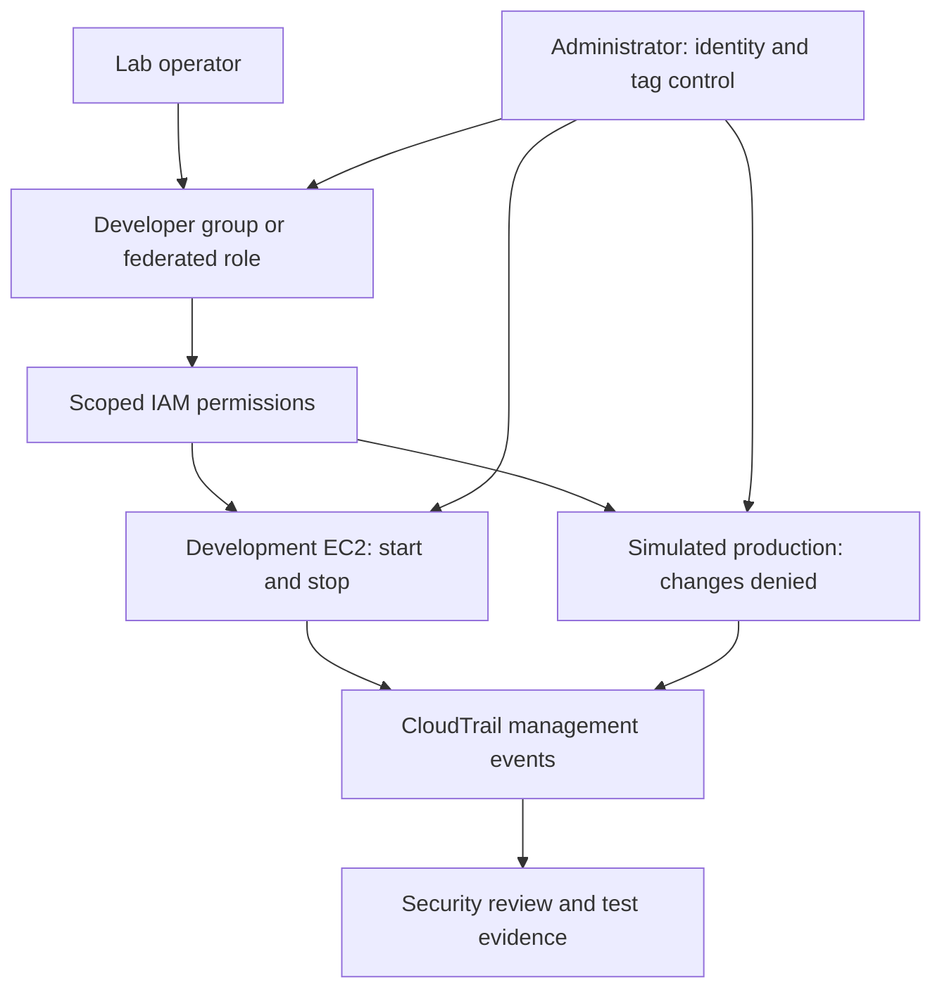

# AWS IAM Access Governance and Least-Privilege Validation

> **Evidence status:** This document describes the project design and execution procedure. AWS deployment, access-test outcomes and cleanup have not been independently evidenced in the supplied material. Proposed controls are not represented as deployed controls.

## Executive overview

This project examines how a junior cloud operator can perform approved development tasks without gaining authority over production workloads. A fictional organisation operates two Amazon EC2 instances representing development and simulated production. IAM permissions determine which operations the operator may perform; environment tags support resource selection, and CloudTrail provides management-event evidence for investigation.

The project begins with a guided IAM user/group exercise and develops a narrower access design. The portfolio combines requirements, architecture, policy examples, implementation instructions, positive and negative tests, identity lifecycle procedures and risk assessment. It is a single-account educational lab, not a claim of production deployment, complete security or regulatory compliance.

## Project status

| Component | Current documented status |
|---|---|
| Repository organisation | Visible in the supplied VS Code screenshot |
| Scope, access model and procedures | Documented in this package |
| Proposed least-privilege policy examples | Included; not deployed or AWS-validated here |
| EC2 instances, IAM user/group and source policy | Source tutorial describes them; actual configuration not evidenced |
| Access tests and CloudTrail investigation | Procedures complete; actual outcomes not evidenced |
| Federation, MFA enforcement and lifecycle execution | Proposed extensions; not evidenced |
| Resource cleanup and costs | Not evidenced |

## Security objectives

1. Permit only approved development instance lifecycle operations.
2. Prevent production lifecycle changes by the developer.
3. Prevent changes to tags that influence authorisation.
4. Separate workload operation from identity administration.
5. Make authorisation behaviour observable and explainable.
6. Validate role changes and access removal rather than assuming they are immediate.

## Architecture

This diagram represents intended access, not an observed deployment. Denied API attempts should be checked in CloudTrail where recorded; the diagram is not a guarantee that every failed console interaction produces an event.

## Documentation

| Document | Purpose |
|---|---|
| [Scope and requirements](docs/01-scope-and-requirements.md) | Business scenario, user stories and acceptance criteria |
| [Access design](docs/02-access-design.md) | Roles, ABAC, trust boundaries and decisions |
| [Implementation manual](docs/03-implementation.md) | Step-by-step build, rationale and verification |
| [Validation](docs/04-validation.md) | Test matrix, procedures and results status |
| [Identity lifecycle](docs/05-identity-lifecycle.md) | Joiner, mover, leaver and review workflow |
| [Risks and limitations](docs/06-risks-and-limitations.md) | Risk assessment, treatment and residual exposure |
| [Cleanup and lessons](docs/07-cleanup-and-lessons.md) | Teardown, handover and design analysis |
| [Policy documentation](policies/README.md) | Source policy evaluation and replacement examples |
| [Diagram documentation](diagrams/README.md) | Architecture and lifecycle diagrams |
| [Evidence register](evidence/README.md) | Required evidence and publication rules |

## Technical scope and skills

AWS IAM, EC2, resource tags, JSON permissions, RBAC, resource-tag-based ABAC, policy evaluation, CloudTrail investigation, identity lifecycle governance and Git documentation. Federation and temporary credentials are a target enhancement, subject to student-account capabilities.

## Important design boundary

EC2 metadata visibility is allowed for selected Describe operations. The developer may therefore see production instance metadata while lacking permission to modify the instance. In addition, a tag filter inside one account does not provide the same isolation as separate production and development AWS accounts.

## Reproducing the lab

Read the scope and design first, check account permissions and cost exposure, then use the implementation manual. Replace sample account and Region values in policy examples before validating them in AWS. Record your actual resource names, attachments, policy versions and outcomes. No infrastructure has been created by generating this repository.

## References

- [AWS IAM security best practices](https://docs.aws.amazon.com/IAM/latest/UserGuide/best-practices.html)
- [EC2 service authorisation reference](https://docs.aws.amazon.com/service-authorization/latest/reference/list_ec2.html)
- [EC2 start/stop permissions based on tags](https://docs.aws.amazon.com/IAM/latest/UserGuide/reference_policies_examples_ec2-start-stop-tags.html)
- [CloudTrail event history](https://docs.aws.amazon.com/awscloudtrail/latest/userguide/view-cloudtrail-events.html)
- [AWS policy evaluation logic](https://docs.aws.amazon.com/IAM/latest/UserGuide/reference_policies_evaluation-logic.html)

The source learning exercise is NextWork's *Cloud Security with AWS IAM*, supplied as tutorial text. The exact source URL was not included in that text. The least-privilege redesign, requirements, governance model and validation plan in this repository are extensions to that exercise.
