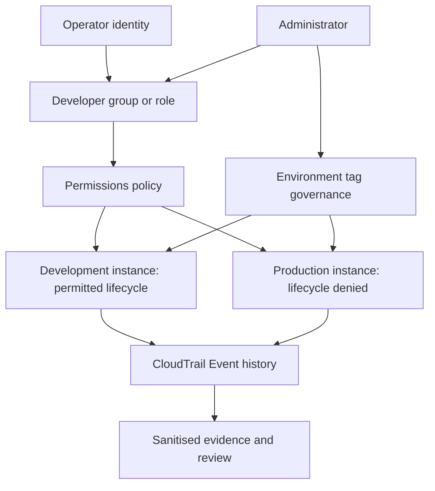
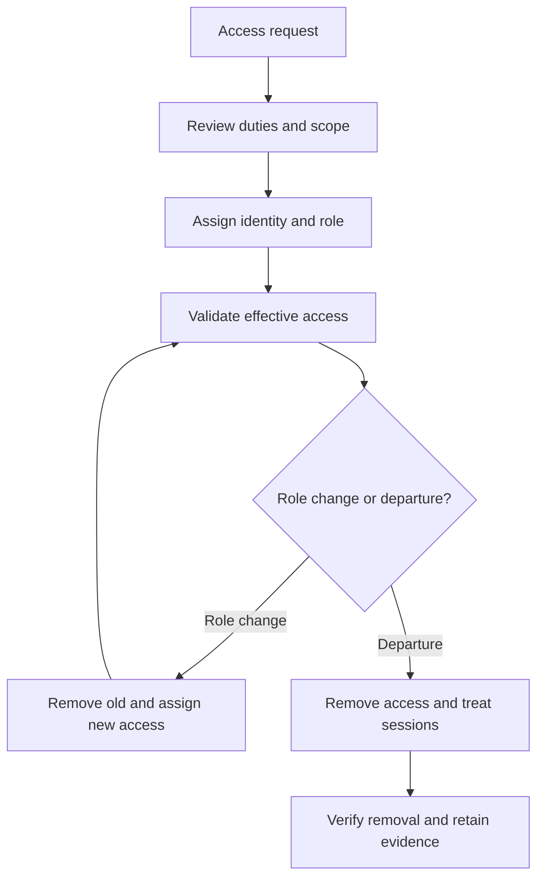

# Architecture and Lifecycle Diagrams

> **Evidence status:** This document describes the project design and execution procedure. AWS deployment, access-test outcomes and cleanup have not been independently evidenced in the supplied material. Proposed controls are not represented as deployed controls.

## Architecture diagram

The following Mermaid source renders on GitHub. It depicts the intended base design. The administrator manages assignment and tags; the operator receives limited workload permissions. These edges represent authority and audit flow, not network connectivity.

## Identity lifecycle diagram

## Editing in diagrams.net

Create an AWS account boundary containing the IAM policy and two EC2 resources. Put the human operator outside that boundary and label the authentication path. Label all resource environments as simulated. Use separate arrows for permitted lifecycle, denied lifecycle, administrator tag management and audit review. Include a legend, version and status: proposed until observed configuration is verified.

Save the editable source and an exported PNG/SVG here, then link the export in the main README. Do not add VPC, subnet, firewall or application details that were not actually designed. Federation and separate accounts belong in a separately labelled target-state diagram if implemented or proposed.

## Review criteria

The diagram must agree with actual resource scope and policy actions. Describe access is broader than development lifecycle access. A group must not be labelled as an assumable role. CloudTrail is an audit service, not an inline enforcement component. A denied UI operation is not automatically a recorded API event.
