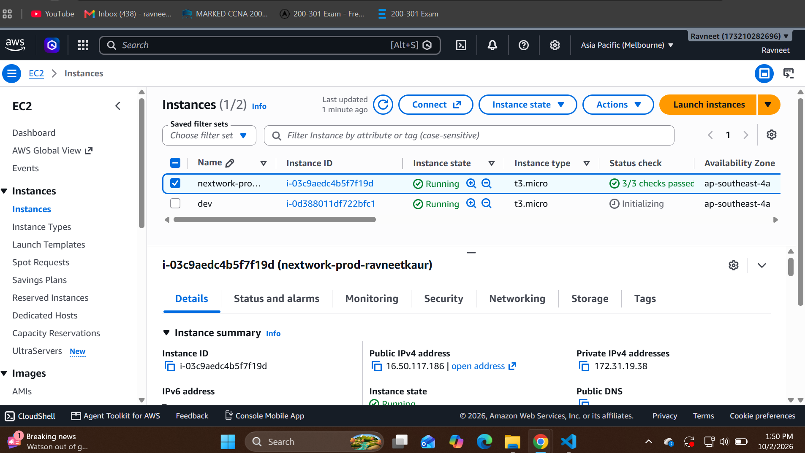
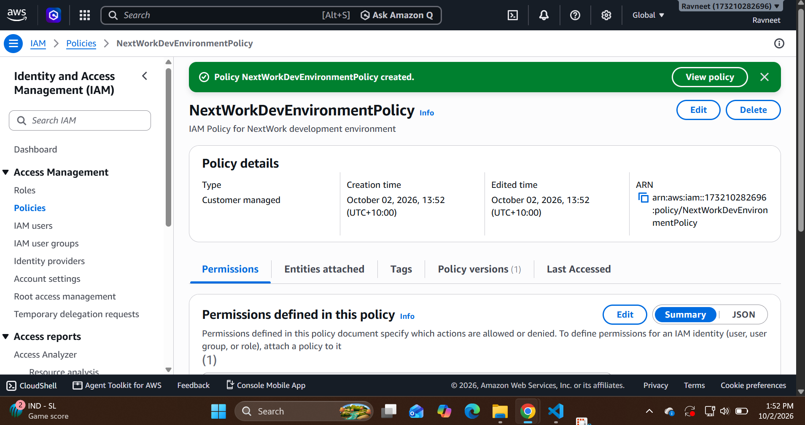
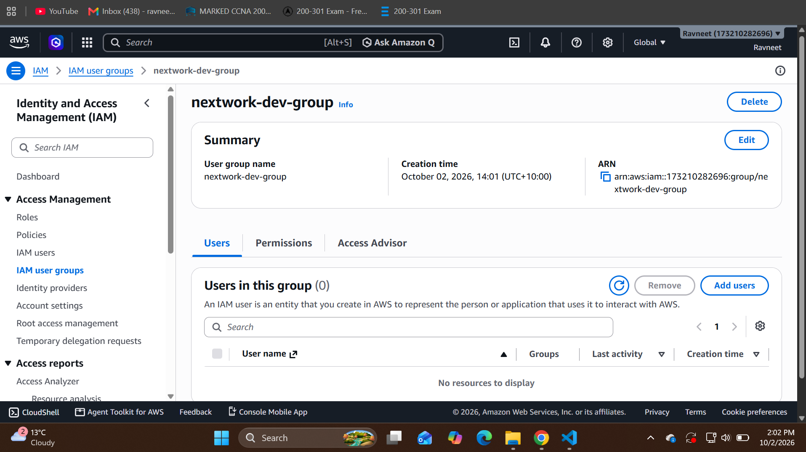
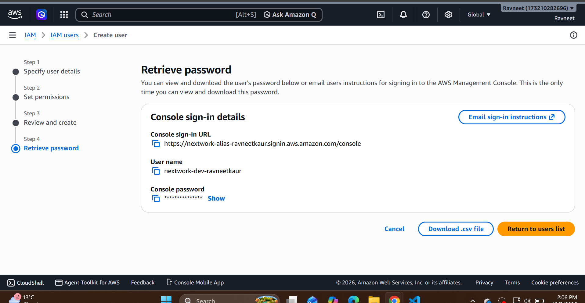

# Implementation and Verification Manual

> **Evidence status:** This document describes the project design and execution procedure. AWS deployment, access-test outcomes and cleanup have not been independently evidenced in the supplied material. Proposed controls are not represented as deployed controls.

## Execution status

The supplied manual describes an EC2/IAM exercise. It does not establish deployed values or successful operations. The following is the complete execution runbook. Record actual completion and supporting evidence as each step is performed.

## 1. Establish the baseline

Sign in with an authorised administrator identity. Confirm that the account permits IAM changes and EC2 provisioning. Record account type and Region privately; use sanitised identifiers in the public portfolio. Check account credits, instance eligibility and billing. Budget notifications are alerts, not a guaranteed spending cap. Do not select an instance merely because a tutorial calls it free.

Open a separate browser profile/incognito session for the operator later. Keep the administrator and operator sessions distinguishable. The student must not test permissions using an administrator and attribute them to the restricted identity.

**Evidence:** sanitised inventory record and preparation notes. **Purpose:** make configuration reproducible and avoid identity/Region confusion.

## 2. Inventory or create EC2 resources

If the tutorial's two instances already exist, inspect them before creating duplicates. Otherwise open EC2, choose Launch instance, and configure two small Linux instances appropriate to the account's eligible resources. Suggested project names are `iam-lab-dev-01` and `iam-lab-prod-01`; retain existing names if resources were already created.

Set Env to development or production as appropriate and Project to iam-access-governance. Review storage, encryption and deletion behaviour. Require IMDSv2 when available. Disable public IP assignment and leave inbound security-group rules empty because lifecycle API tests need no OS connection. No SSH key is needed for this API-only scope; lack of a key is not itself evidence of secure management. Do not attach a privileged instance role.

Record instance IDs, Region, tags, volume IDs and initial states privately. Capture sanitised tags and instance-state evidence. Two instances in one account simulate environments but do not create separate environment trust boundaries.

## 3. Preserve and evaluate the source policy

The tutorial policy grants ec2:* subject to Env=development, permits ec2:Describe* and denies CreateTags/DeleteTags. Save the exact deployed policy if this exercise was completed. The included `source-tutorial-policy.json` is transcribed from the supplied tutorial, not an export of your account.

Review the policy against the role requirement. Its action scope exceeds the start/stop job definition, and conditions cannot be assumed to apply identically to every EC2 action. Explain the redesign before replacing it. The Version field selects the IAM policy language; it is not the creation date of your policy.

## 4. Prepare the redesigned policy

Open `policies/development-operator.example.json`. Replace sample account 123456789012 and ap-southeast-2 with the actual scope. If only one instance should be operable, replace the allow statement's wildcard instance ARN with its exact ARN. Leave Resource * where required for selected Describe calls.

Open IAM > Policies > Create policy > JSON. Paste the reviewed JSON. Inspect AWS validation errors, warnings and security findings; correct them before creation. Name the policy `IAMLabDevelopmentOperator`. Preserve the final JSON as the actual deployed export after validation. Do not claim the example was validated solely because it parses as JSON locally.

The developer policy allows StartInstances/StopInstances on development-tagged instances, explicitly denies those actions on production-tagged instances, and denies tagging and termination. IAM administration is not granted. Additional console permissions must be investigated individually and justified; do not solve a console error with AdministratorAccess.

## 5. Configure the test identity

For the source exercise, create a group `iam-lab-developers` and attach the custom development policy. Create a dedicated IAM console user `iam-lab-developer`, require password change, and add the user to that group. Configure MFA before operational use. Avoid direct user policies and unrelated managed policies. No credentials belong in the repository.

If an existing user/group was created through the tutorial, inspect it and document the actual names and attachments. A name change is optional; do not destroy working configuration merely to match this manual.

Optionally create an account alias if needed and authorised. If the account already has an alias, preserve it. Do not publish password or MFA setup pages.

## 6. Review effective permissions

Inspect user policies, group memberships, role assignments and relevant account guardrails. Confirm the operator has no unrelated broad grants. Check that the intended policy version is active. Where available, use IAM Access Analyzer policy validation and Policy Simulator. Record simulated results separately from live API outcomes.

**Evidence:** group assignment, policy export, policy attachment inventory and validation findings. **Purpose:** prove the effective access model rather than a single policy's intended appearance.

## 7. Execute base access tests

Sign in as the operator in the isolated browser session and choose the resources' actual Region. Confirm identity through the console identity menu. Follow TC-01 through TC-09 in the validation document. Development stop/start tests need suitable starting states. Production stop/start tests may temporarily require the administrator to put the simulated production instance in the relevant state.

Before any negative destructive test, inspect effective permissions. Use EC2 API dry-run for termination where suitable, or simulation if no safe invocation is available. Record the method and its evidence limitation. Never risk a real workload to obtain an AccessDenied screenshot.

## 8. Investigate audit events

Open CloudTrail Event history in the relevant Region as the administrator or reviewer. Filter by event name and time. Look for StartInstances, StopInstances, CreateTags, DeleteTags and other applicable management actions. Allow for event delivery delay. Correlate userIdentity, timestamp, target/resource details and errorCode/errorMessage where present.

Event history exposes recent management events and does not provide indefinite retention or every data event. A failed console interaction may not have sent an API request. If no event is found, investigate Region, time and whether the request occurred; document the absence rather than fabricating correlation. Export sanitised records for completed tests.

## 9. Implement optional role separation

Use the production and reviewer example policies only after defining actual account scope and validating them. Assign separate identities/groups for a simple IAM user lab, or separate permission sets/roles for an approved federation implementation. Test that production operators cannot modify development and reviewers cannot change either workload. The security-reviewer example is an EC2/CloudTrail reviewer; it does not claim full IAM governance read access.

## 10. Implement federation if supported

Check whether your student account supports the required Identity Center/organisation or identity-provider configuration. Use approved federation, separate permission sets and short-lived sessions. Document identity source, assignments, session settings and MFA controls. If account restrictions prevent this, record the limitation and retain the IAM user lab as an explicit exception. Do not create unsupported organisation infrastructure to satisfy the portfolio title.

## 11. Perform lifecycle and cleanup

Execute the joiner, mover and leaver procedure. Record fresh versus existing session results. Save sanitised evidence before removing resources. Follow the cleanup checklist and review billing afterward. Update all status statements only when supporting evidence exists.

## Troubleshooting guide

| Symptom | Investigation | Appropriate correction |
|---|---|---|
| No instances visible | Region, Describe permissions and actual resource existence | Correct Region or add justified read permission |
| Development start denied | Env value/case, ARN scope, active policy and guardrails | Correct diagnosed configuration and retest |
| Production change allowed | Caller identity, other grants and policy attachment | Contain access, correct control and rerun failed tests |
| Tag edit allowed | Explicit deny attachment and actual API used | Review all tagging paths and effective permissions |
| CloudTrail event absent | Event delay, Region, timestamp and actual request | Expand investigation; report missing evidence |
| Permission persists after removal | Remaining policies, assumed-role credentials and session lifecycle | Remove remaining path/revoke where supported; retest |

## References

- [AWS IAM security best practices](https://docs.aws.amazon.com/IAM/latest/UserGuide/best-practices.html)
- [EC2 service authorisation reference](https://docs.aws.amazon.com/service-authorization/latest/reference/list_ec2.html)
- [EC2 start/stop permissions based on tags](https://docs.aws.amazon.com/IAM/latest/UserGuide/reference_policies_examples_ec2-start-stop-tags.html)
- [CloudTrail event history](https://docs.aws.amazon.com/awscloudtrail/latest/userguide/view-cloudtrail-events.html)
- [AWS policy evaluation logic](https://docs.aws.amazon.com/IAM/latest/UserGuide/reference_policies_evaluation-logic.html)

The source learning exercise is NextWork's *Cloud Security with AWS IAM*, supplied as tutorial text. The exact source URL was not included in that text. The least-privilege redesign, requirements, governance model and validation plan in this repository are extensions to that exercise.

### EC2 instance inventory

Two t3.micro lab instances are running in the Melbourne Region.

### IAM policy creation

AWS confirms creation of NextWorkDevEnvironmentPolicy.
The policy JSON and attachments are not shown.

### Developer group creation

The nextwork-dev-group was created. It contains zero users
at the time of this screenshot.

### Developer user creation

The IAM user creation workflow reached the console sign-in details
page. Group membership and MFA configuration are not shown.