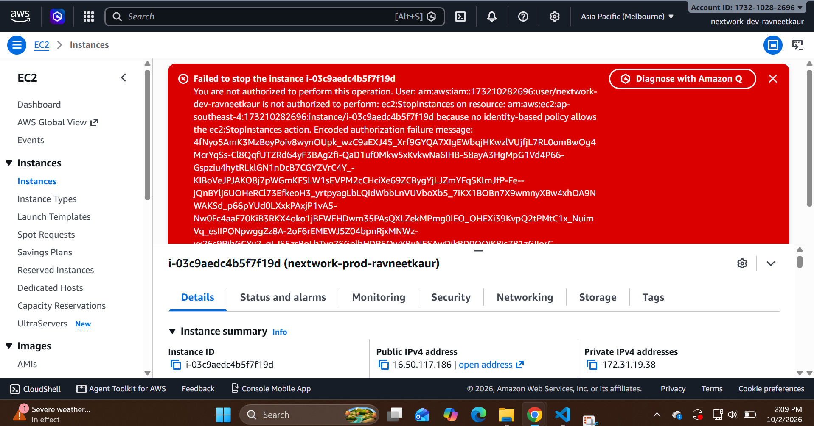

# Access Validation and Results

## Methodology

Positive tests establish useful authorised access. Negative tests examine production, tagging, destructive operations and identity administration. Edge tests cover missing/malformed tags. Tests must identify the principal and starting state, avoid unrelated policy grants, and distinguish simulator predictions from live API behaviour.

## Test matrix

| ID | Principal and operation | Expected result | Actual result | Evidence |
|---|---|---|---|---|
| TC-01 | Developer: selected EC2 Describe operations | Allowed; production metadata may be visible | Not evidenced | E-04 |
| TC-02 | Developer: stop running development instance | Allowed | Not evidenced | E-05 |
| TC-03 | Developer: start stopped development instance | Allowed | Not evidenced | E-06 |
| TC-04 | Developer: stop running simulated production | Denied | Not evidenced | E-07 |
| TC-05 | Developer: start stopped simulated production | Denied | Not evidenced | E-08 |
| TC-06 | Developer: relabel production as development | Denied | Not evidenced | E-09 |
| TC-07 | Developer: remove development Env tag | Denied | Not evidenced | E-10 |
| TC-08 | Developer: terminate development (dry-run/simulation) | Denied | Not evidenced | E-11 |
| TC-09 | Developer: create IAM user | Denied | Not evidenced | E-12 |
| TC-10 | Former operator: retry after removal | Denied after relevant propagation/session treatment | Not evidenced | E-13 |
| TC-11 | Developer: start instance with missing Env tag | No applicable allow | Not evidenced | E-14 |
| TC-12 | Developer: start instance tagged Env=Development | No applicable allow for mismatched value | Not evidenced | E-15 |
| TC-13 | Reviewer: correlate operations with CloudTrail | Appropriate events and identity evidence retrieved | Not evidenced | E-16 |
| TC-14 | Production operator: production start/stop; development change | Production allowed; development denied | Not evidenced | E-17 |
| TC-15 | Reviewer: read audit events; try workload change | Read allowed; changes denied | Not evidenced | E-18 |
| TC-16 | Mover: old role removed, new role assigned | No obsolete privileges after session considerations | Not evidenced | E-19 |
| TC-17 | Policy evaluation: overlapping allow and explicit deny | Explicit deny wins in applicable scope | Not evidenced | E-20 |

## Detailed execution

TC-01: verify operator identity, open EC2 in the chosen Region and inspect listed instances. Record which metadata is visible. Do not mistake seeing an instance for permission to operate it.

TC-02/03: have the administrator establish a running development instance; record state; stop as developer; wait for stopped; start as developer; confirm final state. Match each operation to a timestamp and audit record where available.

TC-04/05: use only the simulated production resource. Administrator sets a valid initial state. Attempt the corresponding change as developer; preserve denial details and confirm the resource did not transition due to that request.

TC-06/07: attempt Env changes as developer. Confirm both request denial and unchanged tags from an administrator view. A missing UI button alone is not proof of API denial; document simulation/API checks if needed.

TC-08: use a reviewed EC2 TerminateInstances dry-run request with the isolated principal when feasible. DryRunOperation indicates permission would be allowed; UnauthorizedOperation indicates authorisation failure. Do not issue a real termination as a negative test. A simulator-only result must be identified as such.

TC-09: attempt a minimal IAM CreateUser request using the operator, if safe and within lab authorisation. If it unexpectedly succeeds, remove the synthetic user through the administrator and treat it as a failed control, not a passed test.

TC-10/16: follow lifecycle procedures and test both new sign-in and any existing session. Record removal time, policy propagation interval, session treatment and the last successful operation if applicable. Retest after addressing residual access.

TC-11/12: administrator temporarily changes the development instance tag or uses a dedicated test resource; operator attempts start in a valid state; administrator restores the intended tags. Snapshot/tag changes and restoration must be recorded. These are test-induced configuration changes, not normal operator capability.

TC-13: correlate at least one permitted and one denied API operation when recorded. Preserve event names, event IDs, timestamps, principal details and errors. Document any missing events and the investigation performed.

TC-14/15: execute only after the additional roles are actually deployed. Verify identity before testing. A read-only console appearance is insufficient proof that API write access is denied.

TC-17: use simulator-based comparison of a narrow allow with an applicable explicit deny. Avoid attaching a broad live grant simply to prove deny precedence. This establishes evaluation reasoning, not a deployment claim.

## Result record and failure handling

Each executed test needs date/time/timezone, caller, policy version, target, initial state, method, expected outcome, actual outcome, evidence reference, explanation and final state. Mark Pass only when outcome and evidence agree. Mark Fail when behaviour violates the requirement; record correction and a new retest without deleting the original failure. Mark Blocked when account restrictions prevent execution and state the consequence.

## Current conclusion

The validation plan covers operational access, bypass attempts, lifecycle changes and audit review. No pass count or successful deployment claim can be established from the tutorial text and repository screenshot alone. Acceptance remains open until test evidence is supplied.

